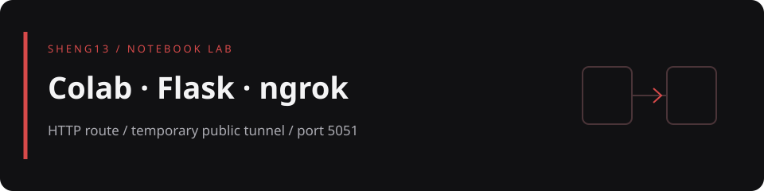

# Colab Flask ngrok lab

在 Google Colab 啟動 Flask，透過 pyngrok 建立臨時公開網址，觀察外部 HTTP 請求如何進入筆記本的 `5051` 連接埠。適合先理解網頁路由與隧道，再銜接 webhook 實驗。

> 目前的 Flask 程式只有 `GET /` 首頁，並未實作 LINE webhook 或 Gemini 對話。安裝儲存格包含相關套件，不代表功能已接上。

[筆記本入口](#notebooks) · [執行順序](#usage) · [檔案地圖](#map) · [安全與限制](#safety)

<a id="notebooks"></a>
## 筆記本入口

| 檔案 | 內容 |
|---|---|
| [_0404_colab_pyngrok_flask_ipynb.ipynb](_0404_colab_pyngrok_flask_ipynb.ipynb) | 安裝套件、讀取 Colab Secret、建立 ngrok 隧道與 Flask 首頁 |
| [「0404_Colab_Pyngrok_Flask_ipynb」的副本.ipynb](「0404_Colab_Pyngrok_Flask_ipynb」的副本.ipynb) | 相同實驗流程的副本，可對照儲存格內容 |

兩份筆記本都以 `google.colab.userdata` 讀取 `NGROK_AUTHTOKEN`，將 `port` 設為 `5051`，並以 `linebot_tunnel` 作為隧道名稱。Flask 的 `/` 回傳示範 HTML。

筆記本中的舊 Colab 徽章仍指向 `sheng13/AI-`。請以本頁實際檔案為準，在 Colab 的「開啟筆記本 → GitHub」輸入 `sheng13/colab-flask-ngrok-lab`，或下載檔案後上傳；本次未修改筆記本。

<a id="usage"></a>
## 執行順序

1. 用 Colab 開啟其中一份筆記本，不要同時執行兩份隧道實驗。
2. 在 Colab 的 Secrets 設定 `NGROK_AUTHTOKEN`，只授權給自己信任的筆記本。不要把權杖直接貼入程式碼。
3. 依序執行安裝、Secret 讀取、匯入模組與隧道儲存格。原始安裝指令為：

   ```python
   !pip install Flask pyngrok line-bot-sdk requests # openai
   !pip install google-genai
   ```

4. 隧道儲存格使用 `ngrok.connect(port, name="linebot_tunnel")` 並印出 `tunnel.public_url`。
5. 執行 Flask 儲存格，保持它運作，再以瀏覽器開啟印出的公開網址。伺服器儲存格持續執行是預期行為。
6. 結束時先中斷 Flask 儲存格，再執行最後的 `ngrok.kill()` 關閉隧道，最後停止 Colab 執行階段。

這份範例直接使用 Colab 專用的 `userdata`；不應把它當成可直接在本機執行的獨立 Flask 專案。儲存格未固定套件版本，若遇到相依性變更，應先記錄錯誤與當次版本，避免盲目修改整個環境。

<a id="map"></a>
## 檔案地圖

```text
.
├── README.md
├── _0404_colab_pyngrok_flask_ipynb.ipynb
├── 「0404_Colab_Pyngrok_Flask_ipynb」的副本.ipynb
├── 梯度縮減範例.png
├── 梯度縮減範例1.png
└── docs/readme-banner.svg
```

根目錄另保留兩張梯度縮減範例圖片；它們不是本次 Flask 服務的驗證證據。頁首 SVG 也是設計橫幅，不是執行畫面。

<a id="safety"></a>
## 安全與限制

- ngrok 網址會把 Flask 路由公開到外網；此範例沒有登入與存取控制。只用測試內容，不要加入私有檔案、帳號資料或管理功能。
- `ngrok.kill()` 會終止同一執行環境的 ngrok 程序，執行前確認沒有其他需要保留的隧道。
- Colab 執行階段、公開網址與網路連線不是常駐服務保證；適合課堂或短時間實驗，不適合直接當正式服務。
- 分享筆記本前先移除執行輸出中的公開網址、權杖與私人資訊；不要假設 Secret 讀取方式能保護後續自行列印的值。
- 本頁依筆記本原始碼整理，未啟動服務、建立隧道或重新安裝套件。